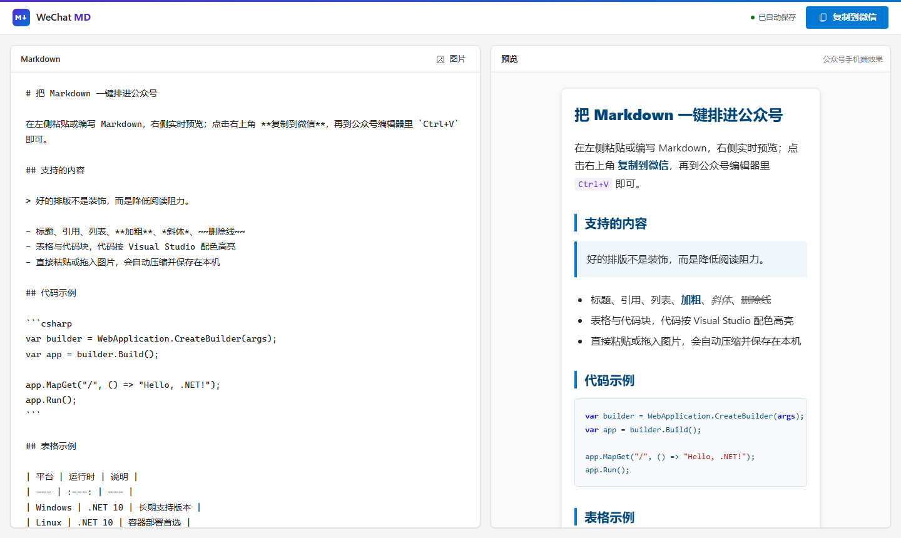

# WeChat MD

粘贴 Markdown，一键复制到微信公众号。

纯前端 `Vite + React + TypeScript` 应用，界面采用 Microsoft Fluent 蓝（`#0078D4`）配 .NET 紫（`#512BD4`）点缀；文章排版只有一套 .NET 蓝主题，代码块使用 Visual Studio 浅色高亮。



## 使用

1. 在左侧粘贴或编写 Markdown，右侧实时显示公众号手机端效果（两侧同步滚动）。
2. 点击右上角 **复制到微信**。
3. 打开公众号编辑器，`Ctrl+V` 粘贴。

草稿自动保存在当前浏览器的 `localStorage`，刷新不会丢失。从旧版（公众号排版助手）升级时，会自动把最近编辑的一篇文章迁移为当前草稿。

## 功能

- CommonMark + GFM：标题、列表、任务列表、表格、引用、删除线、代码块等。
- 代码块语法高亮（C#、TypeScript、Python、SQL、PowerShell 等），样式全部内联，粘贴到公众号后依然保留。
- 粘贴 Word / 网页富文本时自动转换为 Markdown；Markdown 和纯文本按原样粘贴；代码块内粘贴按纯文本处理。
- 本地图片：粘贴或拖入图片会自动压缩并存入 IndexedDB，正文中记为 `asset://图片ID`。复制时以图片 ID 占位块输出（不嵌入 Base64），可在编辑器右上角「图片」中下载后到公众号上传替换。
- 公众号兼容处理：
  - 图片输出为微信原生的 `<p></p>` 结构，表格不再包裹滚动容器，并去除块级元素之间的空白文本节点，避免粘贴后图片、表格前后多出空行。
  - 公众号文章链接保留为链接；其它外链转换为「文字（URL）」可见文本。
  - 任务列表转换为 `☑ / ☐`，多级列表转换为稳定缩进段落。

## 开发

```bash
npm install
npm run dev          # 本地开发
npm run build        # 类型检查并构建到 dist
npm run test         # Vitest 单元测试
npm run test:e2e     # Playwright 端到端测试（可设置 PLAYWRIGHT_CHANNEL=msedge 使用本机 Edge）
npm run check        # 类型检查 + lint + 格式检查 + 单元测试 + 构建
```

推送到 `main` 后由 GitHub Actions 自动部署到 Cloudflare Pages。

## 致谢

基于 [lxw112190/wechat-article-formatter](https://github.com/lxw112190/wechat-article-formatter) 精简重构。

## License

MIT
